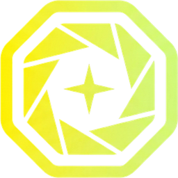
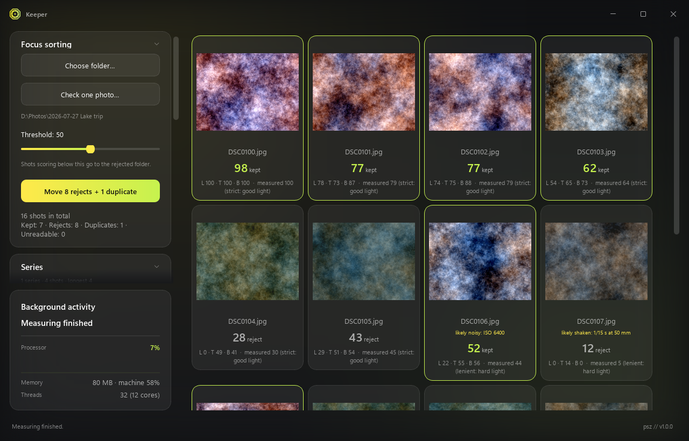
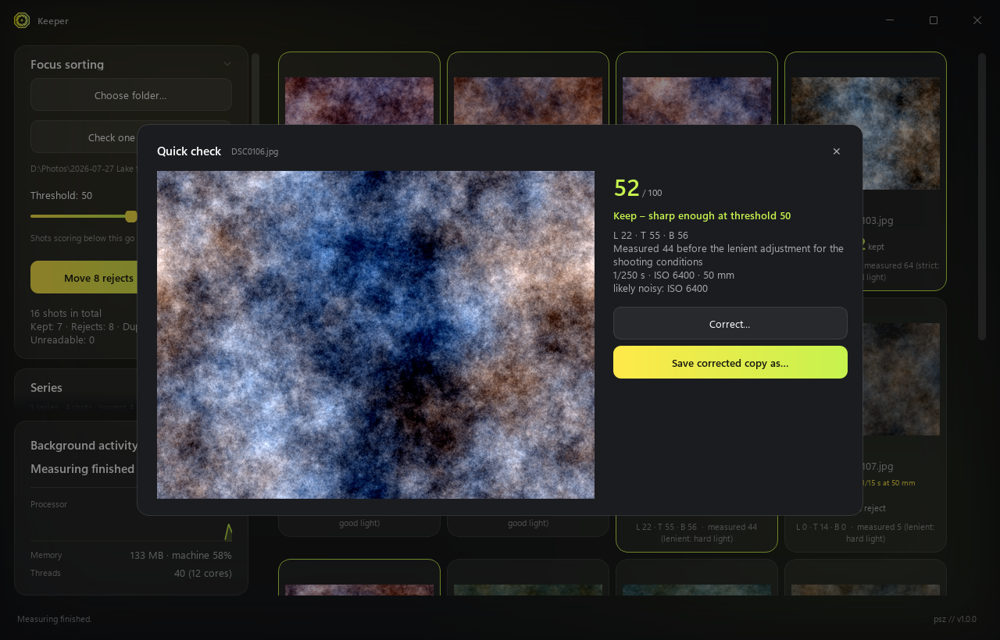
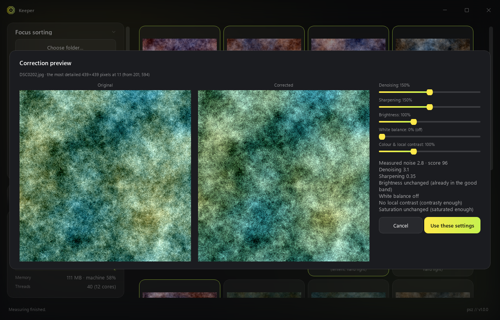
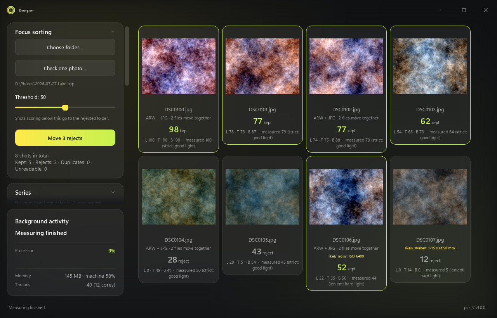
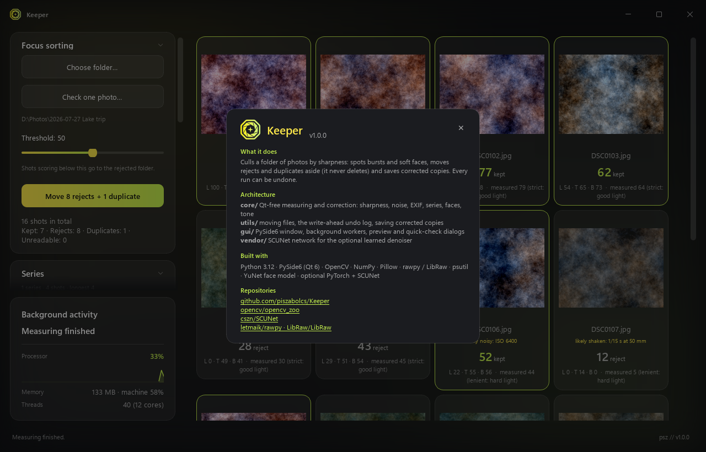
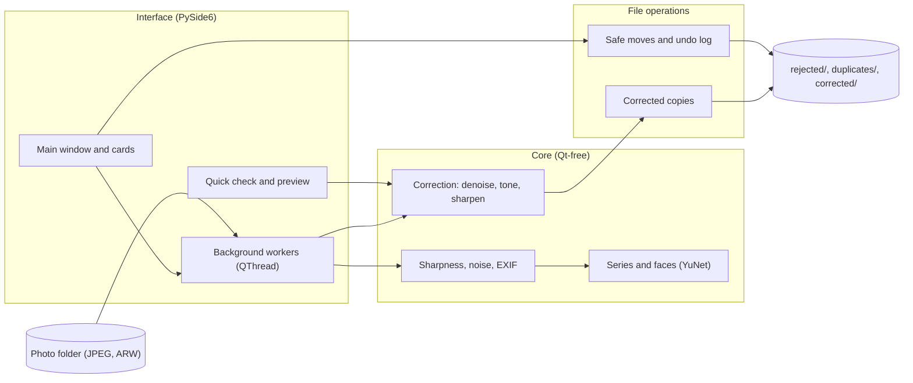

<div align="center">



# Keeper

**Cull a photo shoot by sharpness, set the rejects aside and undo any run**


[Features](#features) · [Screenshots](#screenshots) · [Architecture](#architecture) · [Installation](#installation)

</div>

<p align="center">
  
</p>

## The problem

After a shoot, hundreds of frames wait to be sorted: soft focus, camera shake, bursts of near-identical
shots, and frames where the camera focused on the background instead of the face. Checking each one at
1:1 by eye takes hours, and deleting the wrong original cannot be taken back.

## The solution

Keeper scores every JPEG and Sony ARW in a folder for sharpness, adjusts the verdict for the shooting
conditions read from EXIF, groups bursts into series and measures faces separately. Rejects and surplus
frames are moved aside into subfolders, never deleted, and every run can be undone from a log that is
written before the files move. A quick check gives the verdict for a single dropped photo. Everything runs
locally on the CPU; nothing is uploaded.

## Features

- **Sharpness score.** A 0 to 100 score from three focus metrics (Laplacian variance, Tenengrad, Brenner), normalised by the frame's own contrast with the noise contribution removed.
- **Shooting conditions count.** ISO, shutter and focal length from EXIF make the verdict a little stricter in easy light and more lenient in hard light, with hints such as "likely shaken".
- **Series and duplicates.** Frames taken seconds apart that look alike form a series; the best is starred and surplus frames go to `duplicates/`, not `rejected/`.
- **Faces.** The bundled YuNet model measures face sharpness separately, so a frame focused on the background is caught.
- **Live threshold and overrides.** Cards recolour as the threshold moves, without re-measuring; a click cycles automatic, keep and reject.
- **Corrected copies.** Denoising, sharpening, brightness, white balance and contrast scaled to the measured state, with a 1:1 preview; EXIF and the ICC profile are kept.
- **Quick check.** Drop one photo for an instant verdict and a "Save corrected copy as…" option; nothing is moved or logged.
- **Undo.** Moves are logged before they happen, so even a killed run can be undone; RAW+JPEG pairs always move together.

## Screenshots

<table>
  <tr>
    <td align="center" width="50%"><br/><sub>Quick check: verdict, shooting data, save a corrected copy</sub></td>
    <td align="center" width="50%"><br/><sub>Correction preview: before and after of the most detailed crop at 1:1</sub></td>
  </tr>
  <tr>
    <td align="center" width="50%"><br/><sub>RAW+JPEG pairs are one shot and move together</sub></td>
    <td align="center" width="50%"><br/><sub>About card</sub></td>
  </tr>
</table>

All screenshots are rendered offscreen from synthetic photos by `tools/screenshots.py`; no real photo,
person or path appears in them.

## Architecture



`core/` holds all measuring and correction code and never imports Qt. The window runs it in `QThread`
workers backed by a thread pool, so measuring a large folder keeps the window responsive. `utils/` does the
file work: same-volume moves that refuse to overwrite, the write-ahead undo log and the corrected copies,
which are logged with size and SHA-256. `vendor/` holds the SCUNet network for the optional learned
denoiser.

## Tech stack

| Layer | Technology |
|---|---|
| Language | Python 3.12 |
| Desktop UI | PySide6 (Qt 6), frameless window, `QThread` workers |
| Image analysis | OpenCV, NumPy |
| Image input and output | Pillow, rawpy (LibRaw) for Sony ARW |
| Face detection | YuNet ONNX model (bundled) |
| Optional denoiser | SCUNet with PyTorch and CUDA |
| System data | psutil |
| Tests and CI | pytest, pytest-qt (offscreen), GitHub Actions on Windows |

## Installation

Prerequisites: Windows 10 or 11 and Python 3.12.

1. Clone the repository:
   ```powershell
   git clone https://github.com/piszabolcs/keeper.git
   cd keeper
   ```
2. Create the virtual environment and install the dependencies:
   ```powershell
   py -3.12 -m venv .venv
   .venv\Scripts\python.exe -m pip install -r requirements.txt
   ```
3. Start the app:
   ```powershell
   .\Keeper.bat
   ```
   `Keeper.bat console` starts with a visible console, `Keeper.bat <folder>` opens a folder and
   `Keeper.bat <photo>` the quick check (this also works as "Open with"). `python main.py [folder|photo]`
   does the same on any platform with Qt.
4. Optional, run the tests (offscreen, no window appears):
   ```powershell
   .venv\Scripts\python.exe -m pip install -r requirements-dev.txt
   $env:QT_QPA_PLATFORM = "offscreen"
   .venv\Scripts\python.exe -m pytest -q
   ```

## Usage

1. **Choose folder…** (or drop a folder on the window) and press **Start focus sorting**. Measuring only
   reads; nothing moves.
2. Tune the **threshold**: the cards recolour live. Click cards to override, and use **Series** to protect
   the best frames or mark duplicates.
3. **Move N rejects + M duplicates** moves them into `rejected/` and `duplicates/` inside the folder.
4. Optionally **Save corrected copies** of the kept shots into `corrected/` (preview first).
5. **Undo last run** brings everything back.

For a single photo, drop it on the window or use **Check one photo…**.

### Faces

`assets/face_detection_yunet.onnx` (230 kB, MIT) is included. If it is missing, get it from
[opencv_zoo](https://github.com/opencv/opencv_zoo/tree/main/models/face_detection_yunet) and put it in
`assets/`. Face sharpness refines the verdict and the best-of-series pick; it never rejects a frame by
itself.

### Learned denoiser

The optional SCUNet denoiser needs an NVIDIA GPU, PyTorch with CUDA (about 2.6 GB) and the 72 MB weights
file, which is not in the repository:

```powershell
.venv\Scripts\python.exe -m pip install einops
.venv\Scripts\python.exe -m pip install torch --index-url https://download.pytorch.org/whl/cu126
.venv\Scripts\python.exe tools\download_models.py
```

Without it the classic NLM filter is used and the window says what is missing. The download script checks
the file's SHA-256.

### Notes

- Originals are never deleted or overwritten. The undo log `.keeper_log.json` lives in the processed folder
  and is validated before an undo: only bare file names and Keeper's own output folders are accepted.
  Undoing a correction removes only copies that are still byte-identical.
- Application log: `%LOCALAPPDATA%\Keeper\logs\keeper.log` (rotating, file paths and errors only). Keeper
  writes nothing else outside the processed folder, does not touch the registry and makes no network
  connections apart from the optional model download.
- All tunable values (calibration ranges, folder names, thresholds, strengths) are in `config.py` with
  short explanations.
- Known limits: real Sony ARW files are not part of the test suite and other RAW formats are not enabled;
  heavy noise on blurred frames is not fully subtracted from the score.

## Project structure

```text
keeper/
├── main.py              # entry point: window, optional folder or photo argument
├── Keeper.bat           # Windows launcher (no console; "console" mode for errors)
├── config.py            # all tunable values with explanations
├── core/                # Qt-free measuring and correction: sharpness, noise, EXIF, series, faces, tone
├── gui/                 # PySide6 window, workers, preview and quick-check dialogs, About card
├── utils/               # safe moves, write-ahead undo log, saving corrected copies
├── vendor/              # SCUNet network definition (Apache-2.0)
├── assets/              # icon, mark and the YuNet face model
├── tests/               # pytest suite, offscreen, synthetic images
├── tools/               # screenshots, logo assets, model download
├── licenses/            # third-party licence texts
└── docs/                # logo and screenshots
```

## Roadmap

- [ ] Calibrate the noise correction of the score on high-ISO frames.
- [ ] Add real Sony ARW files to the test suite and enable more RAW formats.
- [ ] Check edge resizing, Snap and mixed-DPI behaviour of the frameless window on real screens.

## License

MIT, see [LICENSE](LICENSE). Third-party components are listed in
[THIRD_PARTY_NOTICES.md](THIRD_PARTY_NOTICES.md): Qt/PySide6 (LGPL-3.0), LibRaw inside rawpy (LGPL-2.1),
OpenCV (Apache-2.0), the redistributed YuNet model (MIT) and the SCUNet network definition (Apache-2.0,
text in `licenses/`).

---

<div align="center">
<sub>Built by Szabolcs Pintér · <a href="https://github.com/piszabolcs">GitHub</a> · <a href="https://www.linkedin.com/in/piszabolcs">LinkedIn</a></sub>
</div>
